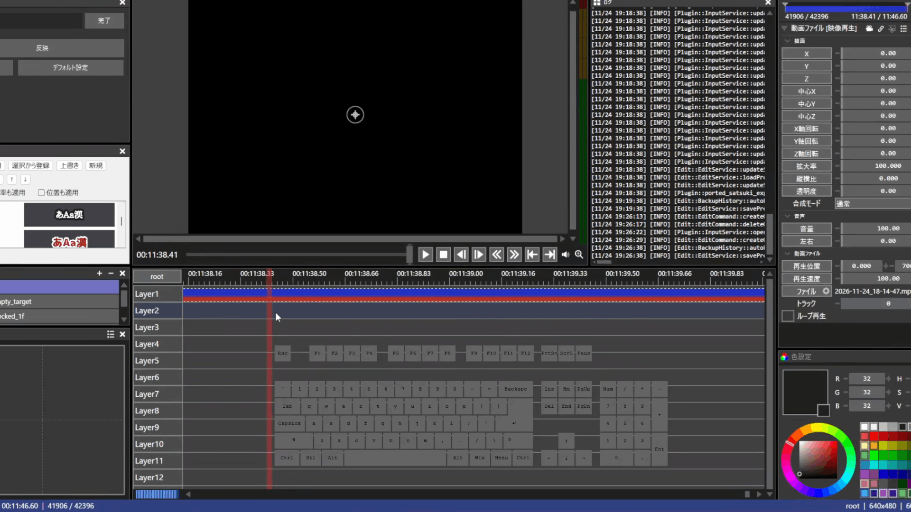

[](https://github.com/RichardLitt/standard-readme) [](LICENSE)

マイク音声をワンボタンで録音・WAV保存し、AviUtl2（AviUtl ExEdit2）のタイムラインへ自動挿入するプラグインです。

## 前提条件

- Windows 10 または Windows 11（64bit）
- AviUtl2（ExEdit2）がインストール済みであること

> 動作確認は AviUtl2（ExEdit2）開発時点の最新版で行っています。AviUtl2 のバージョンアップ後に動作しない場合はリリースページで対応状況を確認してください。

## 概要

AviUtl2 の汎用プラグインです。以下の方法で録音の開始・停止ができます。



- AviUtl2に録音パネルを追加して、録音開始・停止ボタンを押す
- AviUtl2のショートカットキー設定からショートカットキーを設定する
- CLIクライアントを利用する

録音した音声は WAV ファイルで保存し、AviUtl2のタイムラインに挿入されます。

> **対象**: 旧 AviUtl（32bit）ではなく **AviUtl2（ExEdit2、64bit）** のみを対象とします。

## インストール

### AviUtl2 カタログからインストール（推奨）

[aviutl2-audio-rec | AviUtl2 Catalog Web](https://a2cw.sevenc7c.com/package/beive60.aviutl2-audio-rec)

### リリースからインストール

1. [GitHub Releases](https://github.com/beive60/aviutl2-audio-rec/releases/latest) から最新版の zip をダウンロードする。
2. zip を展開する。
3. `aviutl2_audio_rec.aux2` を `C:\ProgramData\AviUtl2\plugins\` にコピーする。
4. `audio_rec_cli.exe` を任意の場所（例: `C:\ProgramData\AviUtl2\plugins\`）にコピーする。

### ソースからビルド

<details>

<summary>ビルド方法はこちらから確認してください</summary>

- [Rust toolchain](https://rustup.rs/) — `x86_64-pc-windows-msvc` ターゲット
- [aviutl2-cli](https://github.com/sevenc-nanashi/aviutl2-cli) — ビルド・デプロイ・パッケージング用 CLI ツール（`au2` コマンド）
- [aviutl2-rs](https://github.com/sevenc-nanashi/aviutl2-rs)（`Cargo.toml` で自動取得）

> aviutl2-rs は開発中の crate であり、API の破壊的変更が発生する可能性があります。

aviutl2-cli は [Releases](https://github.com/sevenc-nanashi/aviutl2-cli/releases/latest) からダウンロードするか、`cargo-binstall` でインストールできます。

```sh
cargo install aviutl2-cli
```

リポジトリをクローンし、初回セットアップを実行します。

```sh
git clone https://github.com/beive60/aviutl2-audio-rec.git
cd aviutl2-audio-rec
au2 prepare
```

`au2 prepare` は AviUtl2 本体のダウンロード・展開と、設定ファイルの JSON Schema 出力、成果物へのシンボリックリンク作成を一括で行います。

#### 開発ビルド

```sh
au2 develop
```

プラグイン（`.aux2`）と CLI（`.exe`）をビルドし、開発用 AviUtl2 ディレクトリに自動で配置します。

#### リリースパッケージの作成

```sh
au2 release
```

リリース用にビルドしたパッケージ（zip）を生成します。生成された zip には以下のファイルが含まれます。

| ファイル | 説明 |
| --- | --- |
| `aviutl2_audio_rec.aux2` | AviUtl2 プラグイン本体 |
| `audio_rec_cli.exe` | CLI クライアント |

</details>

## 使い方

### 初期設定

※ 録音を行うには、あらかじめ保存先フォルダの設定が必要です。

設定は AviUtl2 のヘッダーメニュー「設定 → プラグイン設定 → `[AudioRec] 設定...`」から行います。ダイアログで以下を変更できます。

- 保存先（フォルダ選択ダイアログで指定）
- バッファサイズ（既定値 / 1024 / 2048 / 4096 / 8192）

<details>

<summary>CLI クライアントから設定する方法</summary>

デフォルト保存先の設定:

```powershell
audio_rec_cli.exe config save-path "C:\録音"
```

バッファサイズの設定:

```powershell
audio_rec_cli.exe config buffer-size 4096
audio_rec_cli.exe config buffer-size 0 # デフォルト値に戻す
```

`config save-path` / `config buffer-size` サブコマンドで設定を保存します。設定は `%PROGRAMDATA%\AviUtl2\audio_rec_cli.json` に JSON 形式で永続化され、CLI とプラグイン UI メニューで共通利用されます。

</details>

### AviUtl2 録音パネルでの操作

AviUtl2 内のウィンドウクライアントとして `録音パネル` が追加されます。ヘッダーメニュー > 表示 > 録音パネルで表示してください。

- 開始ボタン
- 停止ボタン
- 録音状態インジケータ（`● 録音中` / `○ 停止中`）

録音パネルの開始/停止ボタンは、編集メニューの `録音開始` / `録音停止` と同じコマンド経路を利用します。

### AviUtl2 ショートカット（メニュー）での操作

AviUtl2 の編集メニュー > プラグインに以下が追加されます。

- `AudioRec\録音開始`
- `AudioRec\録音停止`

これらのメニューはショートカットキーの設定からショートカットキーを割り当てることができます。

- 編集: AudioRec\録音開始
- 編集: AudioRec\録音停止

`録音開始` は共有設定の保存先とバッファサイズを使用して録音を開始します。

### Stream Deck 統合

Stream Deck のプラグイン「Advanced Launcher [BarRaider]」を使用することを推奨します。

※ デフォルト保存先を設定しておいてください。

- Application に `audio_rec_cli.exe` のパスを指定してください（AviUtl2 カタログから導入した場合は `C:\ProgramData\AviUtl2\plugins\audio_rec_cli.exe`）
- 録音開始は Arguments に `start`、録音停止は Arguments に `stop` を入力してください
- LAUNCH SETTINGS の Background にチェックを入れてください

### CLI での操作

AviUtl2 が起動した状態で実行します。出力先 WAV ファイルパスは省略可能です（[初期設定](#初期設定)で設定したデフォルト保存先に保存されます）。

録音を開始します。

```sh
audio_rec_cli.exe start "C:\recordings\take1.wav" # 出力先を明示
audio_rec_cli.exe start # デフォルト保存先 + 自動ファイル名（yyyymmdd-hhmmss.wav）
```

録音を停止します。停止後、収録した WAV がタイムラインのカーソル位置に自動挿入されます。

```sh
audio_rec_cli.exe stop
```

設定後は `start` にパスを渡さなくてもデフォルト保存先と自動生成ファイル名（例: `20260426-001234.wav`）が使用されます。デフォルトが未設定のままパスを省略すると明確なエラーが表示されます。

成功すると終了コード 0 で終了します。エラー時は標準エラー出力にメッセージが表示され、非ゼロの終了コードで終了します。

## 仕様・よくある質問

- マイクはWindowsのデフォルト（既定）のマイクを使用します。スタート > 設定 > システム > サウンドから設定してください。
- 挿入される音声オブジェクトはタイムラインのカーソル位置を起点に配置されます。カーソル位置にオブジェクトがある場合、同一のレイヤーの後ろ側に空いている位置に配置されます。

## 開発者向け情報

### アーキテクチャ

```txt
[Stream Deck ボタンなど]
       |
       v
[audio_rec_cli.exe] --UTF-8(command)--> [Named Pipe]
       |                                      |
 audio_rec_cli.json                [aviutl2_audio_rec.aux2]
（デフォルト保存先）                    (ワーカースレッド)
                                              |
                                      WASAPI 録音セッション
                                              |
                                       WAV ファイル出力
                                              |
                                   タイムライン自動挿入
                               （カーソル位置・レイヤーに配置）
```

### IPC プロトコル

| 項目 | 仕様 |
| --- | --- |
| 通信方式 | Named Pipe（`\\.\pipe\aviutl2_audio_rec`） |
| 方向 | CLI クライアント ↔ プラグイン（双方向） |
| エンコーディング | UTF-8 |
| ペイロード | コマンド（`start`/`stop`）。`start` は `start:<buffer_frames>:<path>` 形式もサポート |
| 最大ペイロード長 | 65,536 バイト |

`config save-path` / `config buffer-size` サブコマンドはパイプを使用せず、`%PROGRAMDATA%\AviUtl2\audio_rec_cli.json` を直接更新します。

### 実機回帰テスト

個人開発向けの最小実機回帰セットと運用ルールは以下を参照してください。

- [regression/README.md](regression/README.md)

## クレジット

- [sevenc-nanashi/aviutl2-rs](https://github.com/sevenc-nanashi/aviutl2-rs) — AviUtl2 Plugin SDK の Rust バインディング。本プロジェクトのプラグイン実装はこの crate に依存しています。
- [aviutl2-cli](https://github.com/sevenc-nanashi/aviutl2-cli) — AviUtl2 のプラグイン・スクリプト開発用コマンドラインツール。本プロジェクトのプラグインの開発はこのツールを使用して行われています。

## コントリビューション

Issue や Pull Request を歓迎します。[GitHub Issues](https://github.com/beive60/aviutl2-audio-rec/issues) で質問・提案を受け付けています。

詳細は [CONTRIBUTING.md](CONTRIBUTING.md) を参照してください。

## ライセンス

[MIT](LICENSE) © 2026 べいぶ
